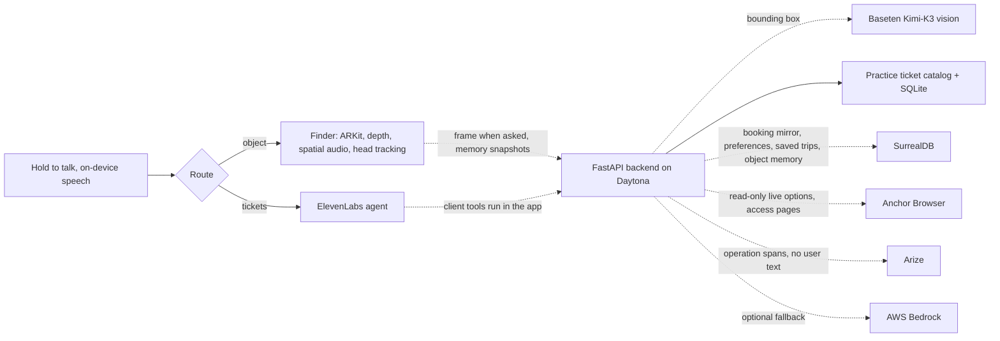

# Faith architecture

Faith is a native iPhone app with one full-screen hold-to-talk surface. On-device speech recognition routes each request: object requests go to the finder, anything about tickets, trips, showtimes, or preferences goes to the ElevenLabs booking agent. There is no web client.

## The finder

Each request captures a snapshot (upright JPEG, camera pose, intrinsics, depth). Faith first checks object memory; if the object isn’t remembered at a position from the current AR session, the frame is sent as soon as the user lets go (asking is the consent). The backend returns only a 2D box; the phone turns it into a world point using the snapshot’s own pose and depth or a detected surface. There is no fixed-depth fallback. Guidance is binaural audio steered by AirPods head tracking, plus haptics and recorded voice lines. While the finder is open, memory snapshots every few seconds (only when the view changed) stay on the phone; the backend lists their objects without storing them, and SurrealDB keeps only names, places, times, and AR positions. Positions guide only within the AR session that measured them. See [object finding](OBJECTS.md).

## The booking agent

The app asks the backend for a short-lived ElevenLabs conversation token, then talks to a private agent. The agent’s tools run in the app, against the backend:

| Tool | Backend | Notes |
| --- | --- | --- |
| `search_live_tickets` | `POST /api/real-search` | Live options from fixed provider sites via Anchor, read-only |
| `choose_live_option` | none | Shows the option for hold to choose |
| `save_trip` | `POST /api/trips` | Saves the chosen option and provider link; only after the user's own yes |
| `search_tickets` | `POST /api/search` | Fictional practice inventory, only when live search fails |
| `propose_booking` | `POST /api/quotes` | Server-owned price, ten-minute expiry |
| `confirm_booking` | `POST /api/bookings` | Only if the user’s own latest words say yes, checked in the app |
| `check_venue_accessibility` | `POST /api/access-info` | Read-only Anchor summary of a fixed public page |
| `remember_preferences` / `get_preferences` / `forget_preferences` | `PUT/GET/DELETE /api/preferences` | SurrealDB; saving needs the user’s own request or yes |
| `find_object` | none | Hands off to the finder |

On the choice screen a 1.5-second hold saves the live trip (or books the practice ticket) and a double tap asks for the next option. Booking is idempotent per quote.

## Booking transitions

`search → session-owned offer → expiring quote → explicit confirmation → demo_confirmed → demo_cancelled`

Prices are integer USD cents including fees for the whole group. A unique quote constraint and a per-session idempotency key prevent duplicate tickets. Orders contain no card data or identity.

Sessions are anonymous bearer tokens kept in the iPhone Keychain. They are demo credentials, not production accounts.

## API

| Method | Path | Role |
| --- | --- | --- |
| POST | `/api/session` | Start or resume an anonymous session |
| GET | `/api/capabilities` | Which integrations are configured |
| POST | `/api/agent/session` | ElevenLabs conversation token, today’s date, saved-preference summary |
| POST | `/api/search`, `/api/quotes`, `/api/bookings` | Demo booking flow |
| GET | `/api/bookings` | The session’s tickets |
| POST | `/api/bookings/{id}/cancel` | Cancel a demo ticket |
| POST | `/api/real-search` | Live options for every category, read-only, unverified |
| GET/POST | `/api/trips` | Saved live trips (chosen option and provider link) |
| POST | `/api/access-info` | Provider accessibility summary, unverified |
| GET/PUT/DELETE | `/api/preferences` | Preference memory |
| POST | `/api/objects/locate` | The frame sent when the user asks, strict 2D box |
| POST | `/api/objects/scan` | One memory snapshot: objects, boxes, places; nothing stored |
| GET/POST/DELETE | `/api/objects/memory` | Object memory (names, places, times, positions), `?name=` to recall |
| GET | `/health` | Liveness |

## Real ticketing

Real ticketing would need supplier APIs, price revalidation, holds, payment authorization, issuance, refunds, and reconciliation. A model or browser task cannot establish that a payment or booking succeeded, so Faith never lets one try.
