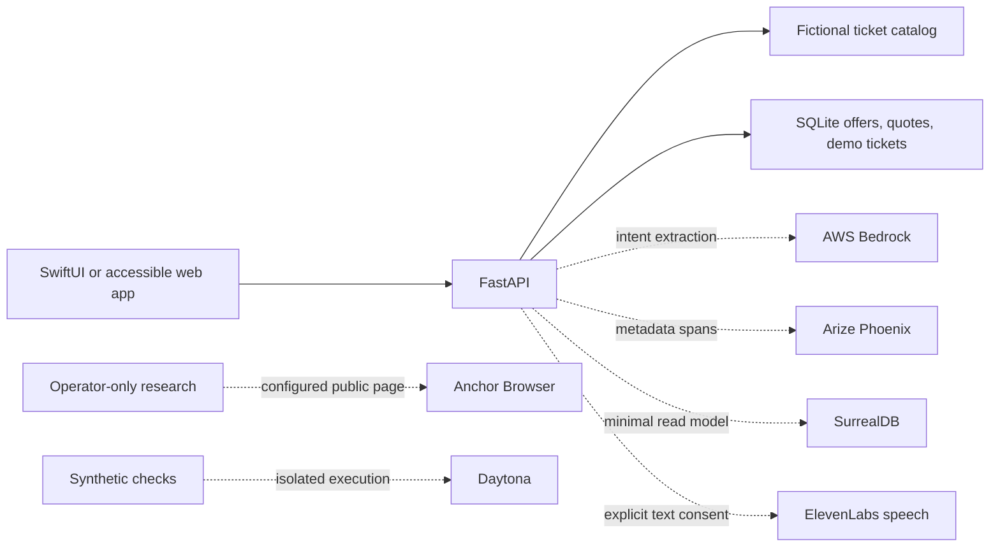

# Faith architecture

Faith supports five ticket categories through one request and booking contract. The interface serves independent channel preferences instead of asking for a diagnosis or assuming a person can hear, speak, see, or perform a gesture.

## Booking transitions

`search → session-owned offer → expiring quote → explicit demo acknowledgement → demo_confirmed → demo_cancelled`

The server supplies immutable quote prices in integer USD cents, including fees for the entire group. Offer and quote identifiers are opaque. Quotes expire after ten minutes. A unique quote constraint and a per-session idempotency key prevent duplicate tickets. Cancellation is idempotent, and replaying confirmation never reactivates a cancelled ticket. Orders contain no card data or personal identity.

Browser sessions use an HttpOnly, SameSite=Strict cookie. Browser writes need the custom client header, and no cross-origin API is enabled. Native clients use a bearer token held in Keychain. Tokens are anonymous local-demo credentials, not production account authentication. A production gateway needs distributed throttling, bounded request bodies, HTTPS, account recovery, and retention controls.

## API

| Method | Path | Role |
| --- | --- | --- |
| POST | `/api/session` | Start/resume an anonymous browser session; issue native bearer token |
| GET | `/api/capabilities` | Report demo/integration configuration; never claim provider connectivity |
| POST | `/api/search` | Validate fields, apply AND access filters and whole-group budget, issue owned offers |
| POST | `/api/assistant` | Prepare search fields; no action tools or purchase authority |
| POST | `/api/quotes` | Create a server-priced, ten-minute review |
| POST | `/api/bookings` | Require `accepted_demo=true`; confirm idempotently |
| GET | `/api/bookings` | Retrieve only the active session’s tickets |
| POST | `/api/bookings/{id}/cancel` | Cancel only the session’s demo ticket |
| POST | `/api/research` | Operator token required; optional public-page research |
| POST | `/api/speech` | Session + `consent=true`, at most 600 characters; bounded MP3 response, no local persistence or automatic retries |
| GET | `/health` | Product and local service health |

FastAPI’s generated schema is available at `/docs`. Use fictional data in development. The local catalog synthesizes travel routes from the requested cities and demo dates; it is not a schedule or availability service. Local events and cinema are in New York.

## Sensor boundaries

Web: DeviceOrientation, enabled only from Access studio, calibrates neutral position, requires a return to center between moves, and changes result focus only. No sensor values are transmitted. Native: Core Motion applies the same threshold/recenter policy. Both stop on backgrounding. Dictation must be started explicitly, produces editable text, and never automatically searches or confirms. Native recognition is on-device only. Speech output and haptics have equivalent visible messages.

## Live-service work

Real ticketing requires provider-specific search, price revalidation, inventory holds, explicit purchase authorization, payment tokenization, supplier booking, ticket issuance, reconciliation, webhooks, refunds, and recovery from ambiguous outcomes. A model or browser task cannot establish that a payment or booking succeeded. Supplier confirmation and payment authority must be distinct from an AI-generated response. Do not add a universal browser checkout agent in place of these contracts.
